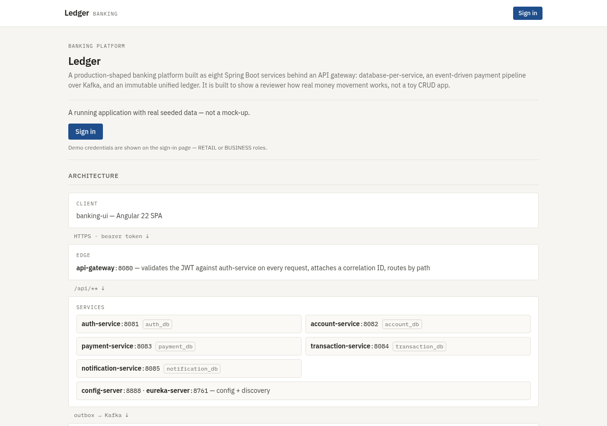
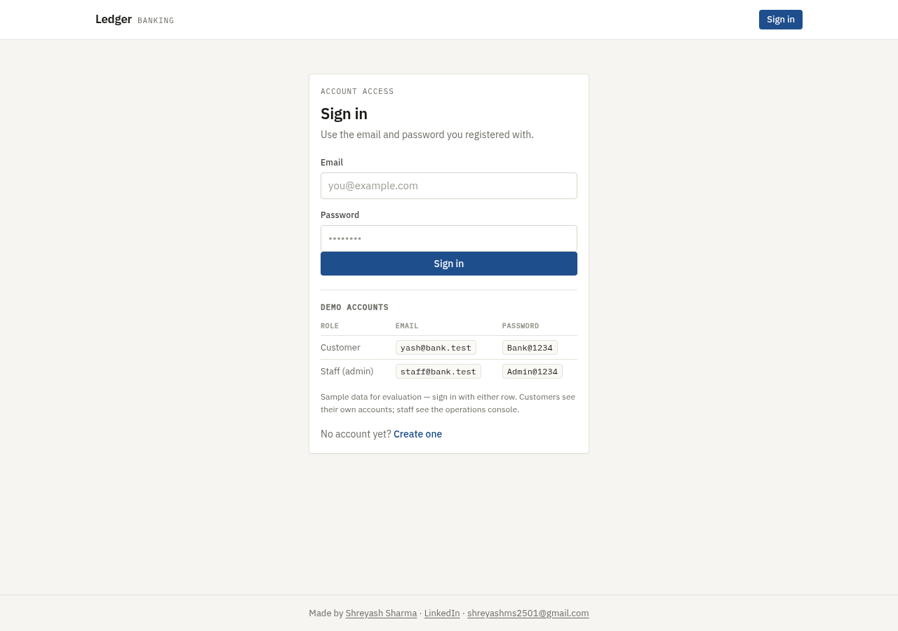
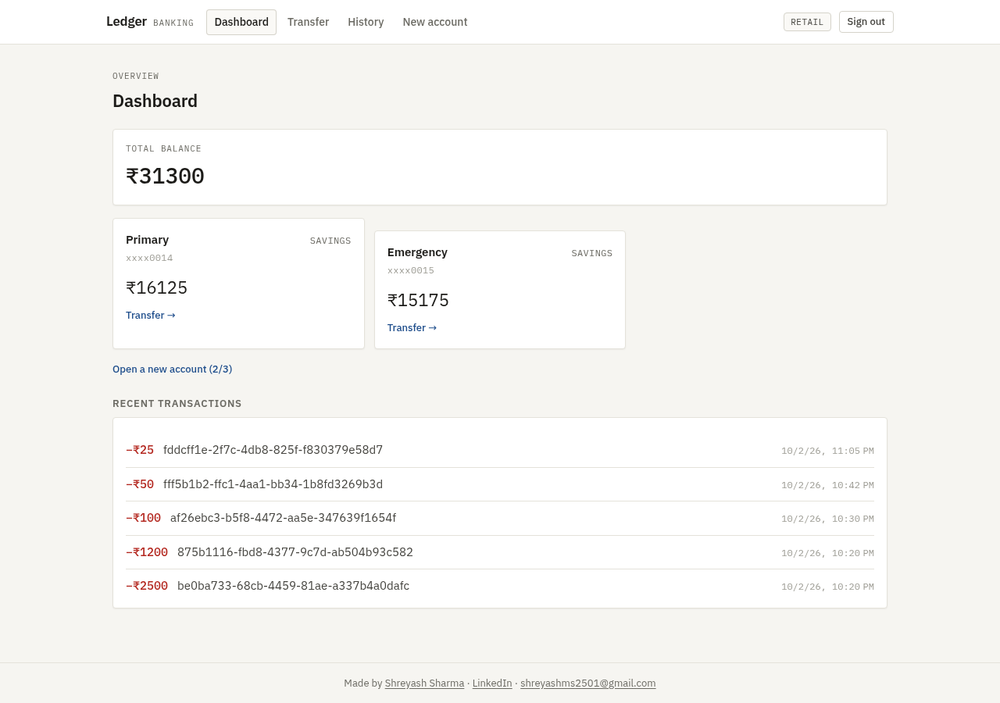
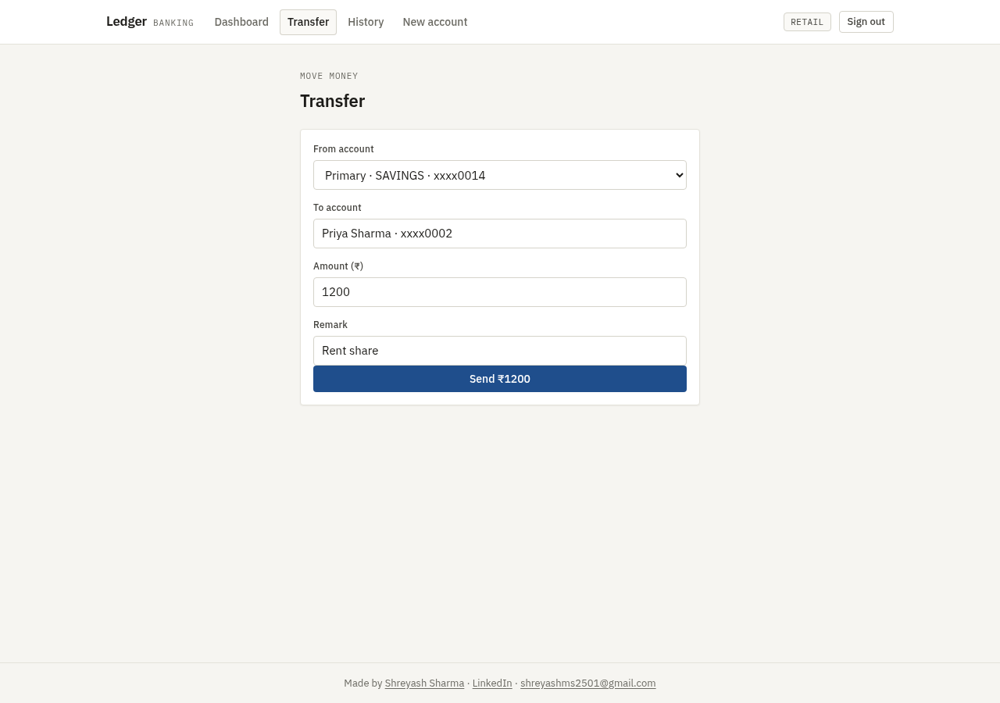
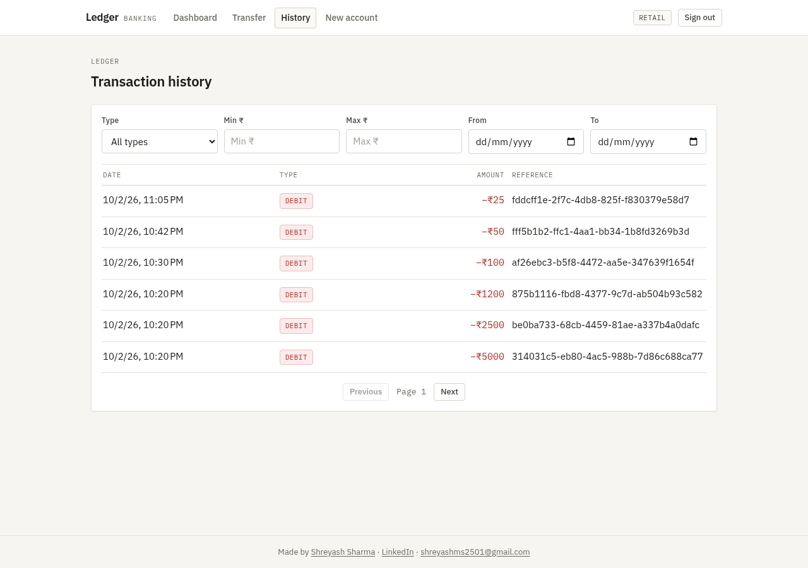
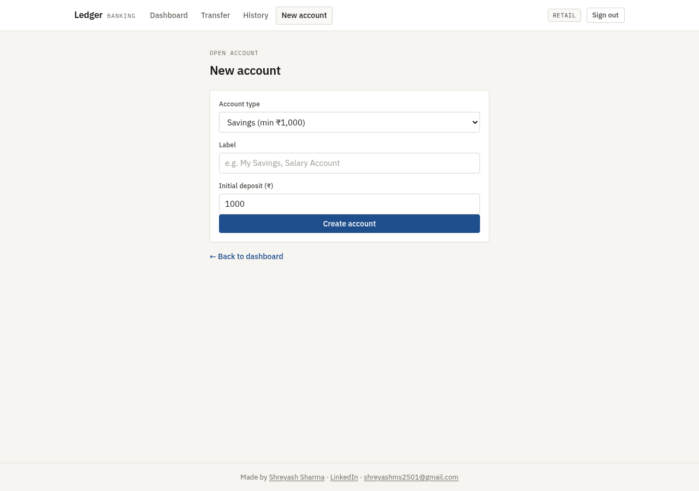
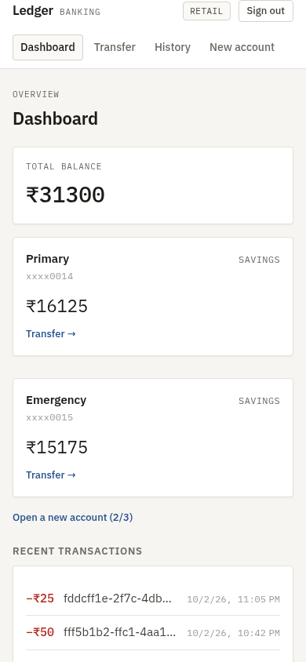

# Ledger — Angular client for the Banking Microservices platform

**Live demo:** https://lighting-fellowship-gordon-post.trycloudflare.com — sign in with any demo account shown on the sign-in page.

The web client for an eight-service Spring Boot banking platform: accounts,
transfers, an event-driven payment pipeline and an immutable unified ledger.



---

## What this is

A single-page Angular application that talks to **one** endpoint — the API
gateway — and holds no business logic of its own. Every screen is a view over
data the platform already owns: the client decides what to *ask for*, never what
is *true*. Balances, limits, account ownership and ledger entries are all
resolved server-side.

It is deliberately not a mock-up. The screenshots in this README are the running
application against the live platform, with seeded customers, real accounts and
real transfers that went gateway → payment-service → Kafka → ledger.

## Architecture

```
                     browser
                        │
        Angular 22 SPA  │  every call is a relative  /api/…
                        ▼
              nginx edge (single origin)
                   /          → the built bundle
                   /api/**     → api-gateway :8086
                        │
                        ▼
     api-gateway — validates the JWT against auth-service on every request,
                   attaches a correlation ID, routes by path
                        │
     ┌──────────────┬───┴────────┬─────────────────┐
     ▼              ▼            ▼                 ▼
 account-service  payment-   transaction-     notification-
    :8082          service     service            service
                   :8083        :8084              :8085
                     │            ▲
                     └── outbox ──┘  (Kafka → immutable ledger)
```

The client never reaches a service directly; it does not know their ports. That
is what makes the same bundle work unchanged on localhost, on a LAN and behind a
public hostname.

## Screens

| | |
|---|---|
| **Sign in** — the three demo accounts are printed on the page, so a visitor needs no briefing.<br> | **Dashboard** — total balance, per-account cards, and the most recent ledger entries.<br> |
| **Transfer** — recipient search resolves a real account before the form will submit.<br> | **Transaction history** — server-side filtering by type, amount range and date, with paging.<br> |
| **New account** — savings and current products with their minimum opening deposit.<br> | **Phone width** — the same dashboard at 390px; no horizontal scrolling, tap targets ≥ 44px.<br> |

## Decisions worth knowing

- **One origin, no CORS.** The edge serves the bundle and proxies `/api/` to the
  gateway, so the browser only ever talks to one host. There is no API base URL
  compiled into the bundle and no CORS allow-list to keep in sync — which also
  means a rotating hostname cannot break it.
- **One interceptor does the cross-cutting work.** `core/auth/auth-interceptor.ts`
  attaches the bearer token and a fresh `X-Correlation-Id` (a UUID) to every
  outgoing request, so a single request can be followed across all eight
  services. It also redacts the token when logging, printing only its last ten
  characters.
- **Route guards per area.** `dashboard`, `transfer`, `history` and `accounts/new`
  require a session; the welcome page and the sign-in page do not, so the app can
  explain itself before asking for credentials.
- **A pre-login front page.** The landing screen states what the platform is and
  shows its topology — the services, their databases and the Kafka hop — before
  the visitor commits to signing in.
- **Design system: information console.** IBM Plex Sans for text, IBM Plex Mono
  for money, account numbers and micro-labels; hairline borders; a 4px radius; at
  most a 1px shadow. Colour is reserved for meaning — credit, debit, success,
  failure, and a single accent. No gradients, no glassmorphism, no decorative
  iconography. Plain CSS, no framework.
- **Honest about its trade-off.** The session token is kept in `localStorage` for
  simplicity. That is a deliberate demo choice, not an oversight; a
  production client would hold it in memory and rely on the refresh flow.

## Demo accounts

Shown on the sign-in page of the running app. These are seeded demo credentials
for a public demo, not a security feature.

| Role | Email | Password |
|---|---|---|
| Customer (retail) | `yash@bank.test` | `Bank@1234` |
| Customer (retail) | `priya@bank.test` | `Bank@1234` |
| Staff (admin) | `staff@bank.test` | `Admin@1234` |

Customers see their own accounts only; the staff account sees the operations
console.

## Running it locally

You need Node 22 and the platform running (see the repository below — it needs
PostgreSQL, Kafka and the eight services; the gateway must be on `:8086`).

```bash
npm ci
npm start          # dev server on http://localhost:4200
npm run build      # production bundle into dist/
npm test           # unit tests (Vitest)
```

In development, `proxy.conf.json` forwards `/api` to `http://localhost:8086`, so
the dev server behaves exactly like the deployed single-origin setup.

## Related

- **The platform itself** — the eight Spring Boot services, their ADRs and the
  ledger design: https://github.com/shreyashsharmaprojects-del/banking-microservices

## Credit

Made by [Shreyash Sharma](https://github.com/shreyashsharmaprojects-del) ·
[LinkedIn](https://www.linkedin.com/in/shreyash-sharma-908b741a9) ·
shreyashms2501@gmail.com
